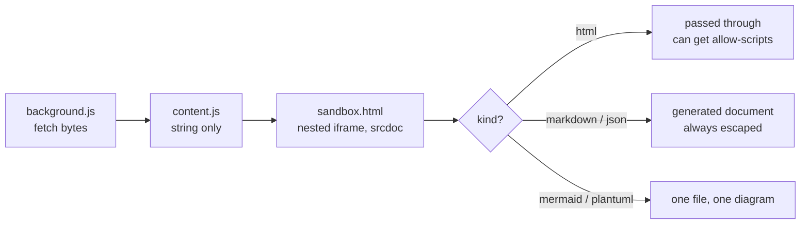
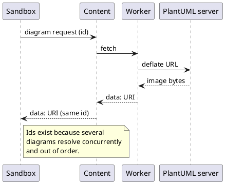

# Markdown preview test fixture

Every section below checks one rule in [src/sandbox/markdown.ts](../src/sandbox/markdown.ts)
or [src/sandbox/highlight.ts](../src/sandbox/highlight.ts). Read the **Expected** line,
then look at what actually rendered.

## 1. Ordinary formatting

**Bold**, *italic*, ***both***, ~~struck through~~, `inline code`, and a
[normal link](https://example.com).

> A blockquote, so the `blockquote` rule in `DOCUMENT_STYLES` gets exercised.

- Unordered item
- Another item
  - Nested item
1. Ordered item
2. Second item

- [x] Task list, checked
- [ ] Task list, unchecked

| Column | Purpose | Passing looks like |
| --- | --- | --- |
| Borders | `table` rules in `DOCUMENT_STYLES` | Visible cell borders |
| Header | `th` styling | Header row stands out |
| Alignment | Long cells | No horizontal overflow of the pane |

---

## 2. The double-escaping trap

**Expected:** both render as literal angle brackets — `<b>` and `</b>` —
**not** as `&lt;b&gt;`.

This is the one that catches a naive fix. Escaping the source *before* parsing looks
right and is wrong: it double-escapes inside code spans and fences. Raw HTML has to be
neutralised per token instead.

Inline: `code <b>with a tag</b> inside`

Fenced, no language tag:

```
<div class="raw">markup inside a fence</div>
<script>alert('this is text, not a script')</script>
```

**Expected:** the block above stays plain and uncoloured — an untagged fence is never
auto-detected, because `highlightAuto` guesses wrong often enough on short snippets that
mislabelled colouring reads worse than none.

## 3. Raw HTML in the source

**Expected:** everything below shows as text. Nothing becomes a live element, no alert
fires, and the heading does not become a real heading.

<h1>This must not render as a heading</h1>
<script>alert('raw html escaped badly')</script>

<iframe src="https://example.com"></iframe>

## 4. Link scheme filtering

**Expected:** none of the first three navigate anywhere. The fourth is a normal link and
should work.

- [javascript: scheme](javascript:alert('nope'))
- [javascript: with a tab inside the scheme](java	script:alert('nope'))
- [data: scheme](data:text/html,<script>alert('nope')</script>)
- [ordinary https link](https://example.com)

The tab one matters: `java<TAB>script:` is a scheme to a browser but not to a naive
regex, which is why whitespace and control characters are stripped before the scheme is
checked.

## 5. Remote images

**Expected:** broken image. `img-src` is `data: blob:` only — no host is reachable from
previewed content, and that is what closes the image-beacon channel.


## 6. Syntax highlighting

**Expected:** each block below is coloured, and strings in them look the same colour as
strings in a `.json` preview — the palette is shared on purpose.

```typescript
export type AttachmentKind = 'html' | 'markdown' | 'json' | 'mermaid' | 'plantuml'

/** The kind is a security boundary, not a display preference. */
export function isScriptable(kind: AttachmentKind): boolean {
  return kind === 'html'
}
```

```python
def deflate_url(source: str, server: str) -> str:
    """PlantUML's deflate + custom-base64 form, not the ~h hex form."""
    packed = zlib.compress(source.encode("utf-8"))[2:-4]
    return f"{server}/png/{encode64(packed)}"
```

```bash
npm run build && node scripts/test-chrome.mjs "$SPACE_URL"
```

```json
{ "previewHtml": true, "allowScriptsByDefault": false, "plantUmlServer": "https://www.plantuml.com" }
```

```sql
SELECT kind, count(*) FROM attachments WHERE preview_ok = false GROUP BY kind;
```

**Expected:** the block below stays plain. An unknown language is not an error — it falls
back to an escaped `<pre><code>`, exactly what shipped before highlighting existed.

```definitelynotalanguage
this should not be coloured
```

**Expected:** the tag inside the fence below shows as text. hljs output is inserted
*unescaped* because it is markup, which rests entirely on hljs escaping as it tokenises.

```html
<script>alert('a live script must not come out of a code fence')</script>
```

## 7. Diagrams in fences

**Expected with diagrams on:** both draw. **Expected with diagrams off in settings:** both
stay ordinary code blocks — and for PlantUML that also means nothing was sent anywhere.





## 8. Long line handling

**Expected:** wraps or scrolls inside the pane; the pane itself never scrolls sideways.

`a-very-long-unbroken-token-aaaaaaaaaaaaaaaaaaaaaaaaaaaaaaaaaaaaaaaaaaaaaaaaaaaaaaaaaaaaaaaaaaaaaaaaaaaaaaaaaaaaaaaaaaaaaaaaaaaaaaaaaaaaaaaaaaaaaaaaaaa-end`
